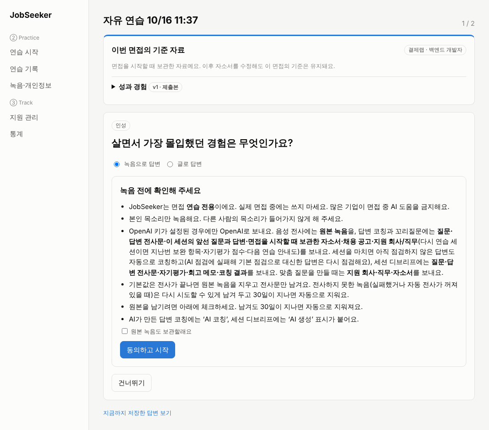
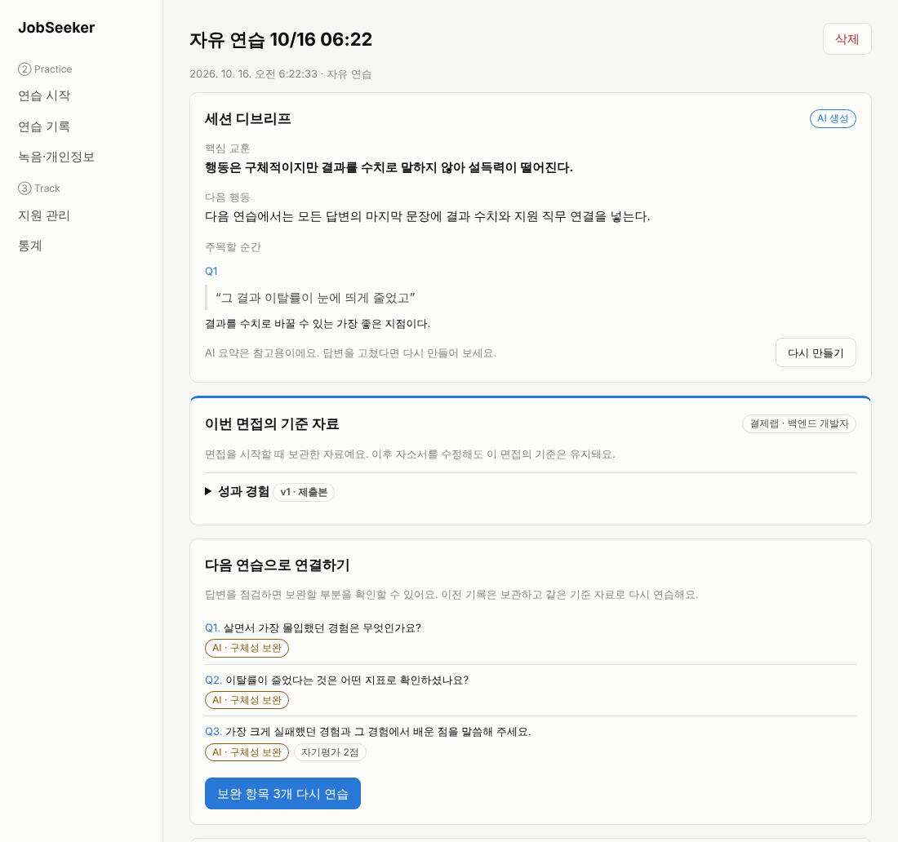
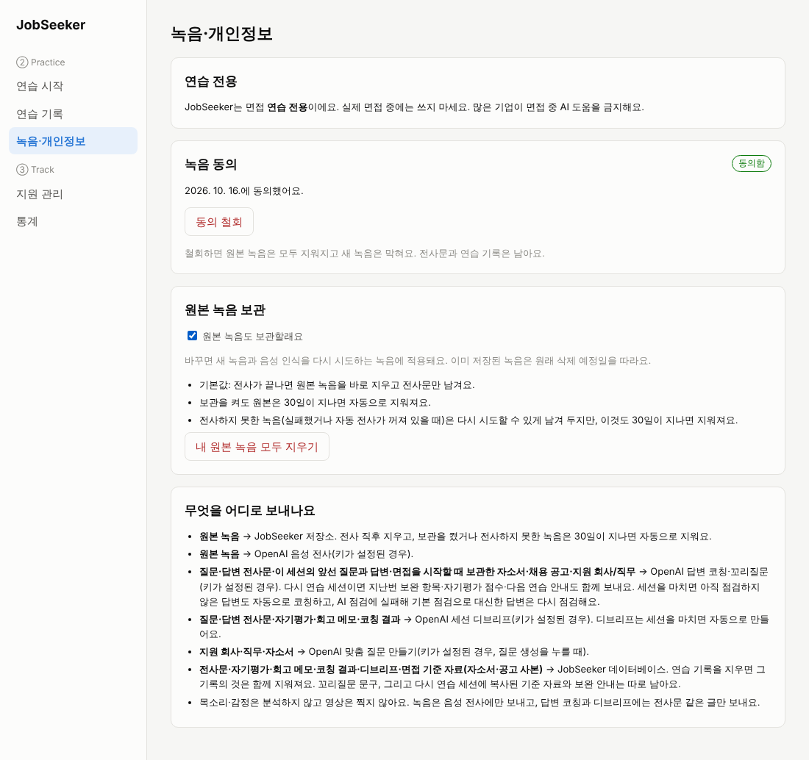

# JobSeeker: ② Practice · ③ Track

## 제출본 기반 면접 코칭 (2026-10-15)

- 면접 설정에서 **제출본 우선 / 최신본**을 선택합니다. 제출 표시가 없는 문항은 최신본을 사용하며 화면에 표시합니다. 면접을 시작하면 회사·직무·자소서 버전과 본문·입력한 채용 요건을 별도로 보관합니다.
- 녹음 또는 **글로 답변**할 수 있습니다. 답변을 확인한 뒤 **꼬리질문 받기** 또는 다음 질문을 선택합니다. 꼬리질문은 원 질문당 한 번이며 이전 답변에 따른 질문이 다른 면접의 질문은행에 섞이지 않습니다.
- 회고의 **답변 점검**에서 구체성·질문 적합성·제출본 연결을 확인합니다. AI가 제시한 답변/자소서 인용은 실제 원문과 대조합니다. API 키가 없거나 호출/인용 검증에 실패하면 **기본 점검**으로 표시하며 의미·진위를 판정하지 않습니다.
- **보완 항목 다시 연습**은 코칭에서 보완이 나온 답변과 자기평가 1~2점 답변을 모아 같은 기준 자료와 질문으로 새 세션을 만듭니다. 기존 세션의 답변·회고는 그대로 남습니다(원본 녹음은 아래 [녹음 개인정보 기본값](#연습-전용-원칙과-p0-기능)에 따라 전사 후 지워집니다).
- 기존 SQLite DB는 서버를 다시 시작하면 새 테이블과 빠진 컬럼이 추가됩니다. 기존 Supabase 프로젝트는 [증분 마이그레이션](supabase/migrations/20261015_interview_coaching.sql)과 [P0 마이그레이션](supabase/migrations/20261015_practice_p0.sql)을 SQL Editor에서 실행해야 합니다(기존 데이터 삭제 없음).

추가 API: `POST /practice/answers/{id}/coach`, `POST /practice/answers/{id}/followup`, `POST /practice/sessions/{id}/redrill`(전체 목록은 [주요 API](#주요-api)).

### 음성 인식·자동 전사

원래 ② Practice의 `Recording & Transcription`에 해당합니다. 브라우저에서 녹음한 답변을 저장한 뒤, 서버가 OpenAI 음성 인식 API로 보내 한국어 전사문을 받아 옵니다. 인식한 문장을 사용자가 확인·수정한 다음 꼬리질문과 답변 점검에 사용합니다.

서버의 `backend/.env`에 `OPENAI_API_KEY`를 설정하고 재시작하면 자동 전사가 활성화됩니다. 기본 모델은 `OPENAI_STT_MODEL=whisper-1`이며 키는 프런트엔드에 넣지 않습니다. 키가 없으면 녹음 저장·재생과 글 답변·기본 점검은 사용할 수 있습니다.

- WebM/MP4 등 파일 형식에 맞는 메타데이터를 전송하고, 재시도에서도 원래 형식을 유지합니다.
- 음성을 인식하지 못하거나 잘못된 응답이 오면 완료로 처리하지 않으며, 녹음을 보관해 다시 시도할 수 있습니다(보관 기한 `AUDIO_RETENTION_DAYS` 안에서).
- 재시도가 실패하면 사용자가 고친 전사문을 유지합니다.
- 음성 인식 서버의 응답을 기다리는 동안 다른 API 요청을 막지 않습니다.

음성 인식 응답을 대체한 테스트로 요청 형식·저장·재시도·오류 처리를 검증합니다. 실제 녹음에 대한 인식 정확도는 실제 API 키를 연결한 후 별도 확인해야 합니다.

[서비스 동작 조사 및 REA 실행 기록](docs/research/interview-products-2026-10-15.md)에는 공개 자료에서 확인한 기능, 실제 분석 명령, 분석이 중단된 환경 조건을 구분해 두었습니다.

브라우저 통합 테스트(백엔드 Python 의존성이 설치된 가상환경에서):

```bash
cd web
npm ci
npx playwright install chromium
npm run test:e2e
```

테스트는 임시 SQLite DB와 전용 포트(8011, 5179)의 서버를 실행하며 기존 개발 서버를 재사용하지 않습니다. `CHROMIUM_EXECUTABLE_PATH`로 기존 Chromium을 지정할 수도 있습니다. 실제 OpenAI 코칭 품질 및 운영 Supabase 연결은 별도 검증이 필요합니다.

캡스톤 설계(26-2) JobSeeker 중 **② AI 인적성·면접 연습**과 **③ 지원 이력·버전 관리** 부분입니다.
발표자료의 스택(React+TS, FastAPI, Supabase, OpenAI)을 그대로 따랐습니다.

```
jobseeker/
├─ supabase/             Supabase에 붙여 넣을 테이블·RLS·Storage 버킷(schema.sql)과 마이그레이션(migrations/)
├─ backend/              FastAPI (Practice·Track API, 테스트 80개)
├─ web/                  React + TypeScript (Vite) 웹 화면
├─ extension-track/      크롬 확장 팝업 (공고 저장, 최근 지원 현황, 대시보드 열기)
└─ docs/screenshots/     실제 실행 화면
```

## 구현한 기능

| 발표자료 항목 | 구현 내용 |
|---|---|
| ② Question Bank & Tailored Questions | 공용 질문은행 30문항(인성·직무·기업·상황·인적성, 직무별), 직접 추가, 지원 건(회사·직무·선택한 기준 자소서)으로 맞춤 질문 생성, 같은 질문 중복 저장 방지 |
| ② Mock Test Mode | 질문 수·준비 시간·답변 제한 시간 설정. 자기소개로 시작하고, 준비 시간이 끝나면 자동 녹음, 제한 시간이 되면 자동 종료 |
| ② Recording & Transcription | 브라우저 MediaRecorder 녹음(마이크 입력 레벨 표시) 또는 글 답변, 첫 녹음 전 동의, Supabase Storage(또는 로컬) 저장, OpenAI STT 전사, 실패 시 재시도, 전사 후 원본 녹음 삭제(보관을 고르면 기한 뒤 자동 삭제) |
| ② Review & Reflection | 녹음 다시 듣기(원본이 남아 있을 때), 전사문 수정, 별점 자기평가, 회고 메모, 답변 코칭(구체성·질문 적합성·제출본 연결, 인용 원문 대조, 키가 없으면 기본 점검), 답변에 따른 꼬리질문, 세션 종료 자동 디브리프, 보완 항목·낮은 자기평가 다시 연습, 분당 발화 글자 수, 연습 기록 목록 |
| ③ Application Records & Stage Outcomes | 지원 건 CRUD, 서류→인적성→1차→2차→최종 단계별 결과 기록(합격 시 다음 단계로 자동 진행) |
| ③ Answer Version Management | 자소서 문항별 버전 이력, 제출본 표시, 단어 단위 비교(diff), 예전 버전으로 되돌리기, 글자 수 제한 표시, 예전 답변 검색 |
| ③ Extension & Web Synchronization | `POST /track/sync`: 크롬 확장(①)이 제출한 지원서를 URL 기준으로 저장하고, 내용이 바뀐 문항만 새 버전으로 쌓음 |
| ③ Statistics by Job Category & Stage | 단계별 도달·통과·탈락·대기, 직무 분류별 단계 통과율, 월별 지원 수 |

## 연습 전용 원칙과 P0 기능

경쟁 서비스 Final Round AI 분석 보고서(프로젝트 공유 폴더 `research/reports/Final Round AI 경쟁 분석.md`)의 로드맵 P0를 위의 답변 코칭 위에 얹었습니다.

- **연습 전용, 녹음 개인정보 기본값.** 실제 면접 중에 답을 띄우는 기능은 만들지 않습니다(Google·Amazon·Anthropic 등이 면접 중 AI 도움을 금지). 첫 녹음 전에 동의를 받고 서버도 동의 없는 녹음 업로드·다시 전사를 403으로 막습니다(글 답변은 동의가 필요 없음). 전사가 끝나면 원본 녹음을 바로 지우고 전사문만 남깁니다. 원본 보관은 사용자가 고를 때만 하고, 보관한 녹음과 전사하지 못한 녹음도 `AUDIO_RETENTION_DAYS`(기본 30일) 뒤 자동 삭제합니다. `/practice/settings` 화면에서 보관 설정(새 녹음과 음성 인식을 다시 시도하는 녹음에 적용), 원본 모두 지우기, 동의 철회(원본 녹음도 모두 삭제)를 할 수 있습니다. 모두 지우기와 동의 철회는 답변 기록이 가리키지 않는 내 저장소 폴더의 파일(예전 버전이 세션을 지우며 남긴 녹음 등)까지 지우고, 만료 정리는 그런 파일을 보관 기한이 지나면 지웁니다. 업로드·다시 전사 도중 동의를 철회하면 그 녹음도 지우고 403으로 답합니다(전사가 이미 끝났으면 전사문만 남김).
- **OpenAI로 보내는 것(키가 설정된 경우만).** 음성 전사에는 원본 녹음, 답변 코칭과 꼬리질문에는 질문·답변 전사문·같은 세션의 앞선 질문과 답변·면접을 시작할 때 보관한 자소서·채용 공고·지원 회사/직무(다시 연습 세션이면 지난번 보완 항목·자기평가 점수·다음 연습 안내도), 세션 디브리프에는 질문·답변 전사문·자기평가·회고 메모·코칭 결과, 맞춤 질문 생성에는 지원 회사·직무·자소서를 보냅니다. 화면에서 쓰지 않는 예전 API `/answers/{id}/feedback`은 질문·전사문·답변 길이를 보냅니다. 목소리·감정은 분석하지 않고, 녹음은 음성 전사에만 보냅니다. 같은 내용을 동의 화면과 설정 화면에 적어 두었고, AI가 만든 답변 코칭에는 'AI 코칭', 세션 디브리프에는 'AI 생성' 표시가 붙습니다(AI 기본법 제31조 고지 의무 대비).
- **세션 종료 자동 디브리프.** 면접을 마치면 백그라운드에서 전사문은 있지만 코칭 보고서가 없는 답변을 `/coach`와 같은 경로로 점검합니다(키가 없으면 기본 점검, 점검 중 전사문을 고친 답변은 버리고 새 전사문으로 다시 점검). 키가 있을 때만 코칭 결과·자기평가·회고 메모로 '핵심 교훈 · 다음 행동 · 주목할 순간(전사문 인용, 서버가 원문과 대조)'을 만듭니다. 키가 없으면 디브리프 상태는 `unavailable`이고 기본 점검만 붙습니다. 회고 화면은 작업이 끝날 때까지 상태를 확인하고, 실패하면 다시 만들 수 있습니다. 서버가 도는 작업이 없다고 하면(서버 재시작 등) 기다리지 않고 바로 '다시 시도'를 보여 줍니다. 만들기·다시 만들기는 지금 서버에 키가 있을 때만 보이며(`/health`), 키 없이 마친 세션도 키를 연결한 뒤 만들 수 있습니다. 작업은 답변 하나를 점검할 때마다 진행 신호를 남기고 신호가 5분 넘게 끊겼을 때만 새 작업을 시작하며, 작업 중에 들어온 종료·재생성 요청은 작업이 한 바퀴 더 돌아 반영합니다. AI 호출이 실패했거나 응답이 검증을 통과하지 못해 기본 점검으로 대신한 답변은 다음 디브리프가 한 번 다시 점검하고, 코칭 보고서는 채점한 전사문의 지문을 함께 저장해 전사문이 바뀐 뒤의 옛 보고서는 없는 것으로 봅니다.
- **다시 연습 확장.** 위의 보완 항목 다시 연습이 자기평가 1~2점 답변도 담습니다(세션 순서대로 최대 20개, 초점 이름 '자기평가 n점'). 회고 요약에 다시 연습할 답변과 이유를 칩으로 보여 주고, AI 코칭에서 나온 이유에만 'AI ·'를 붙입니다.
- **구체성의 STAR 앵커.** 세 기준(구체성·질문 적합성·제출본 연결)의 정의와 충분/보완 앵커를 `backend/app/coaching.py` 한 곳에 두고 코칭 프롬프트와 `GET /practice/rubric`이 함께 씁니다. 경험 질문의 구체성은 STAR(상황·과제가 분명한가, 팀 맥락 속 본인 몫과 판단 근거, 확인 가능한 결과·수치와 배운 점)로 봅니다. 프롬프트에는 엄격하게 채점하기, 없는 강점·사실·수치를 지어내지 않기(꼬리질문도), 말한 내용만 보기, 말버릇 무시, '우리'를 '저'로 바꾸라고 조언하지 않기를 적었습니다. AI 코칭 답변 회고의 '채점 기준 보기'에서 펼쳐 볼 수 있습니다(기본 점검은 이 기준으로 채점하지 않으므로 보여 주지 않고 한 줄로 알립니다). 새 보고서에는 채점 기준 버전 `2026-10-16-star`가 붙고, 예전 버전 보고서는 그대로 둡니다(다시 점검하지 않음).
- **Postgres·로컬 DB.** 모든 id 컬럼이 Postgres에서 uuid로 바인딩되도록 고쳤습니다(전에는 Supabase Postgres에서 서버가 시작하지 못했음). 로컬 SQLite는 서버를 켤 때 빠진 컬럼을 추가하고, 예전 녹음에 녹음 시각과 보관 기한을 채웁니다. 기존 Supabase 프로젝트는 `supabase/migrations/20261015_practice_p0.sql`을 실행합니다(여러 번 실행해도 안전). uuid 형식이 아닌 id는 DB에 보내지 않고 404로 답합니다.
- **새 환경 변수.** `AUDIO_RETENTION_DAYS`(원본 보관 기한, 기본 30), `PURGE_INTERVAL_MIN`(만료 정리 주기, 기본 60분), `OPENAI_FEEDBACK_MODEL`(세션 디브리프 요약 모델, 비우면 `OPENAI_CHAT_MODEL`), `OPENAI_BASE_URL`(OpenAI 호환 API 주소, 기본 `https://api.openai.com/v1`).

근거와 한계: LLM 채점과 전문가 채점의 일치도는 Kendall's τ=.19–.44로 높지 않아서 화면에 'AI 코칭은 참고용'이라고 적고, 점수 대신 인용과 개선 문장을 보여 줍니다. 녹화를 다시 보기만 한 집단은 나아지지 않고 자동 분석 피드백을 함께 받은 집단만 나아졌다는 연구(MACH, N=90)가 자동 디브리프의 근거입니다.





**통과율 정의:** `통과 ÷ (통과 + 탈락)`. 결과가 아직 안 나온 건을 분모에 넣으면 통과율이 실제보다 낮게 나오므로 따로 셉니다.

## 실행 방법

### 1) 백엔드
```bash
cd backend
python3 -m pip install -r requirements.txt
cp .env.example .env        # 값을 비워 두면 로컬 SQLite + 로그인 없이 동작
python3 -m uvicorn app.main:app --reload --port 8000
# API 문서: http://localhost:8000/docs
python3 -m pytest -q        # 테스트
```

### 2) 웹
```bash
cd web
npm install
npm run dev                 # http://localhost:5173
```

### 3) 크롬 확장 팝업
`chrome://extensions` → 개발자 모드 → 압축해제된 확장 프로그램 로드 → `extension-track` 폴더. 자세한 내용은 [extension-track/README.md](extension-track/README.md).

### 4) Supabase 연결(배포 시)
1. Supabase SQL Editor에서 `supabase/schema.sql` 실행. 이미 예전 스키마로 만든 프로젝트라면 `supabase/migrations/`의 `20261015_interview_coaching.sql`과 `20261015_practice_p0.sql`을 실행하면 됩니다(두 파일은 서로 의존하지 않음). 로컬 SQLite는 서버를 켤 때 빠진 테이블·컬럼을 자동으로 추가합니다.
2. `backend/.env`에 `DATABASE_URL`(Connection string), `SUPABASE_URL`, `SUPABASE_SERVICE_ROLE_KEY`, `SUPABASE_JWT_SECRET` 입력, `AUTH_DISABLED=false`
3. `OPENAI_API_KEY`를 넣으면 맞춤 질문(LLM), 전사(STT), AI 답변 코칭·꼬리질문, 세션 디브리프 요약이 켜집니다. 모델은 `OPENAI_CHAT_MODEL`(질문 생성·답변 코칭·꼬리질문), `OPENAI_FEEDBACK_MODEL`(세션 디브리프 요약, 비우면 `OPENAI_CHAT_MODEL`), `OPENAI_STT_MODEL`로 바꿀 수 있어요. 원본 녹음 보관 기한은 `AUDIO_RETENTION_DAYS`, 만료 정리 주기는 `PURGE_INTERVAL_MIN`입니다.

키가 없어도 앱은 동작합니다. 맞춤 질문은 자소서 문장에서 경험 서술을 골라 만드는 규칙 기반으로 대체되고, 전사문은 직접 입력할 수 있으며, 답변 코칭은 기본 점검으로 바뀌고 세션 디브리프 요약은 만들지 않습니다.

## 팀원과 맞물리는 부분

- **로그인(1단계 계정·DB 담당):** 웹에서 Supabase 로그인 후 `setAuthTokenProvider(async () => (await supabase.auth.getSession()).data.session?.access_token ?? null)`만 호출하면 모든 API에 토큰이 붙습니다(`web/src/api.ts`). 백엔드는 토큰의 `sub`를 사용자 id로 씁니다.
  - Supabase 프로젝트가 비대칭 JWT 서명 키(JWKS)를 쓰도록 설정돼 있다면 `backend/app/auth.py`의 HS256 검증을 JWKS 검증으로 바꿔야 합니다.
- **① Apply(크롬 확장):** 지원서 제출 시 `POST /track/sync`로 아래 형식을 보내면 Track에 저장됩니다. 예전 답변 재사용은 `GET /track/answers/search?q=키워드`를 쓰면 됩니다. CORS는 `chrome-extension://` 출처를 허용해 두었습니다.
  ```json
  {"company":"토스","position":"서버 개발자","job_category":"개발","url":"https://...",
   "essays":[{"question_text":"지원 동기","content":"...","char_limit":500}],"submitted":true}
  ```
- **④ Encourage:** 화면 상단 레이아웃(`web/src/App.tsx`)에 팝업 컴포넌트를 끼우면 됩니다.

## 주요 API

| 메서드 | 경로 | 설명 |
|---|---|---|
| GET/POST | `/practice/questions` | 질문은행 조회(분류·직무·출처 필터) / 직접 추가 |
| POST | `/practice/questions/generate` | 맞춤 질문 생성 |
| POST/GET | `/practice/sessions` | 연습 세션 생성(자유·모의) / 목록 |
| GET | `/practice/sessions/{id}` | 세션 상세 |
| POST | `/practice/sessions/{id}/finish` | 세션 종료 + 자동 디브리프 |
| POST | `/practice/sessions/{id}/debrief` | 디브리프 다시 만들기 |
| POST | `/practice/sessions/{id}/redrill` | 보완 항목·자기평가 1~2점 답변으로 새 세션 |
| POST | `/practice/answers/{id}/audio` | 녹음 업로드 + 전사(녹음 동의 필요) |
| POST | `/practice/answers/{id}/transcribe` | 다시 전사(녹음 동의 필요) |
| GET/DELETE | `/practice/answers/{id}/audio` | 원본 녹음 재생 / 삭제 |
| PATCH | `/practice/answers/{id}` | 자기평가·회고·전사문 수정 |
| POST | `/practice/answers/{id}/coach` | 답변 코칭(키가 없으면 기본 점검) |
| POST | `/practice/answers/{id}/followup` | 답변에 따른 꼬리질문 |
| GET | `/practice/rubric` | 코칭 기준(기준별 충분/보완 앵커) |
| GET/PUT | `/practice/settings` | 녹음 동의·원본 보관 설정(동의 철회 시 원본 삭제) |
| DELETE | `/practice/recordings` | 내 원본 녹음 모두 삭제 |
| POST | `/practice/answers/{id}/feedback` | 예전 AI 피드백(화면에서는 쓰지 않음) |
| GET/POST | `/track/applications` | 지원 건 목록(`url`로 찾기 가능) / 추가 |
| POST | `/track/applications/{id}/events` | 단계 결과 기록 |
| POST | `/track/applications/{id}/essays` | 자소서 문항 추가 |
| POST | `/track/essays/{id}/versions` | 새 답변 버전 |
| POST | `/track/versions/{id}/restore` | 예전 버전 복원 |
| POST | `/track/sync` | 확장 프로그램 동기화 |
| GET | `/track/stats` | 통계 |

## 검증한 것

- 백엔드 pytest 126개 통과(사용자 간 데이터 격리, 버전 중복 방지, 동기화 upsert, 통과율 계산, 답변 코칭·인용 검증·꼬리질문, 녹음 동의·원본 삭제·만료 정리·삭제 실패 재시도·고아 파일 정리, 업로드·다시 전사 도중 동의 철회와 삭제, 디브리프·다시 연습·작업 중복과 요청 겹침, 잘못된 형식의 id. OpenAI 경로는 모의 응답으로 확인)
- Playwright 브라우저 테스트(`npm run test:e2e`) 데스크톱·모바일 10개 통과
- 가짜 마이크와 가짜 OpenAI 서버로 동의 → 녹음 → 자동 디브리프(답변 코칭 위) → 다시 연습 → 설정(보관·모두 지우기·동의 철회), 키 없는 모드, 전사 실패·코칭 실패·지어낸 인용·디브리프 실패 같은 실패 경로까지 브라우저에서 145개 항목 확인. 390px 폭에서 가로 스크롤 없음
- 로컬 Postgres 16(Supabase 흉내)에 새 프로젝트(`schema.sql`)와 예전 프로젝트(이전 스키마 + 두 마이그레이션, 두 번 실행)를 만들어 백엔드 흐름 확인
- Chromium + 가짜 마이크로 지원 건 추가 → 자소서 2개 버전·비교 → 단계 기록 → 맞춤 질문 생성 → 모의시험 녹음 2건 → 회고 저장 → 통계까지 실제 화면에서 확인. 콘솔 에러 없고 모바일 폭(390px)에서 가로 스크롤 없음
- 크롬에 확장을 올려 공고 저장 → 같은 공고 재인식 → 대시보드 열기까지 확인(테스트용 가짜 공고 페이지 사용, 실제 채용 사이트에서는 아직 시험 전)
- 실제 OpenAI 키와 Supabase 프로젝트로는 아직 시험하지 않았습니다
