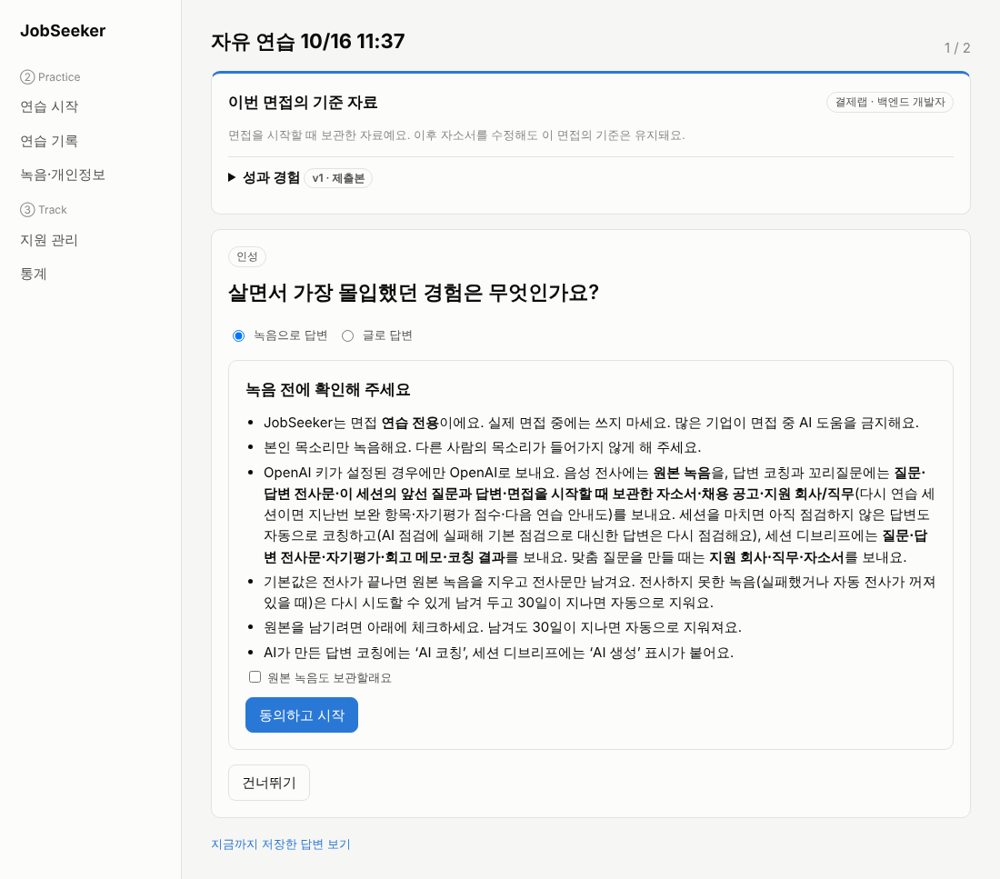
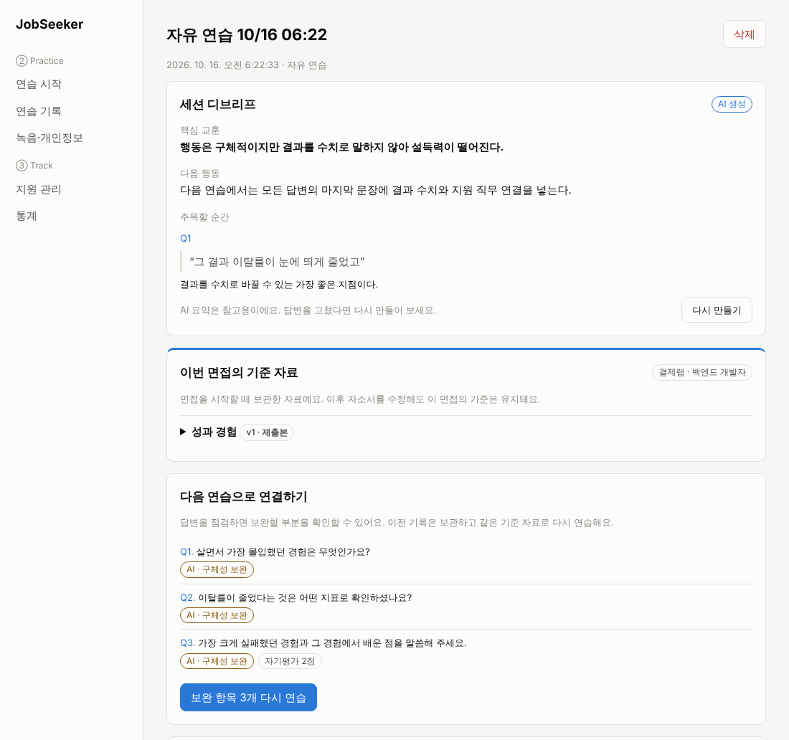
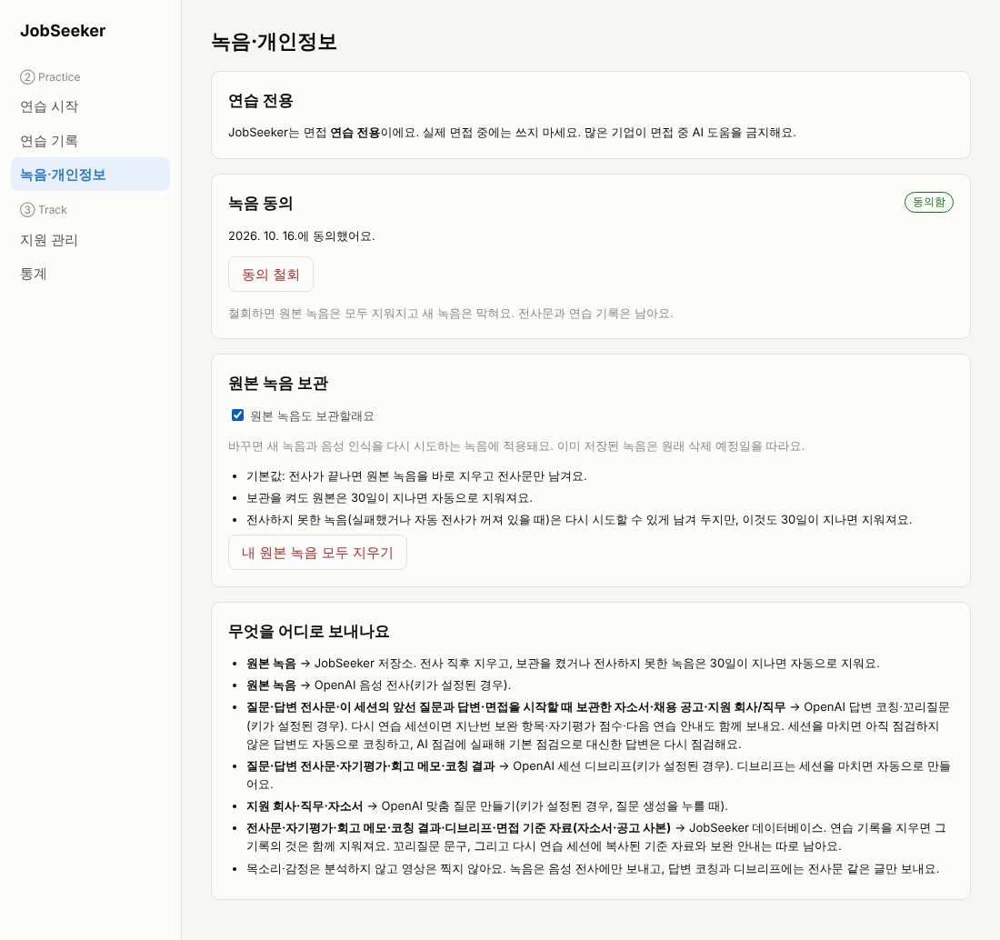

# JobSeeker: ② Practice · ③ Track

## 질문 분류·통합 코칭 (Stage 2)

기존 주제 분류(`category`)와 별도로 질문 유형 여섯 가지와 요구 역량 일곱 가지를 사용합니다. 질문당 역량은 0~3개이며, 질문이 요구하는 역량과 이번 답변에서 AI가 연결한 인용 근거를 구분합니다. 숫자 역량 점수나 합격 가능성은 제공하지 않습니다. 새 세션·꼬리질문은 당시의 분류·표시명·정의를 답변에 고정하고, 다시 연습은 원 답변의 분류를 복사합니다. 옛 답변의 분류가 없으면 그대로 미분류로 남습니다.

새 분류 스키마는 기본 비활성화입니다. 운영 DB를 자동으로 바꾸지 않습니다. [배포 절차](docs/practice-insights-rollout.md)에 따라 새 증분 SQL을 수동 적용하고 검증한 뒤 `PRACTICE_INSIGHTS_ENABLED=true`로 서버를 재시작하세요. 비활성 상태에서는 새 ORM 컬럼도 조회·저장하지 않아 이전 스키마로 기존 기능을 계속 사용할 수 있습니다. 분류 기능을 켜면 질문은행 필터·수동 분류·생성 선호 조건·역량별 연습 범위를 사용할 수 있습니다.

통합 회고는 기존 한눈에 보기와 디브리프를 확장합니다. 항목별 근거·다음 행동, 답변별 우선 보완점, 전체 연습을 설명하는 한국어 코칭 글, 원문과 보완 자리를 구분한 답변 구성안을 제공합니다. 키가 없거나 AI가 실패해도 확인 가능한 자료만 쓰는 제한적 기본 안내가 동작합니다. 전사문이 바뀌면 옛 코칭·디브리프를 현재 평가처럼 표시하지 않습니다. 입력 지문이 없는 예전 디브리프는 현재 평가와 구분한 보관 원문으로 열람할 수 있습니다. 녹음 revision과 최초 자동/사용자 확인 전사문을 함께 묶는 연결 지문을 저장하며, 이후 수정된 글이나 연결을 확인할 수 없는 옛 기록은 R1을 포함한 속도 계산·비교에서 제외합니다. 음성 인식이 꺼져 있을 때 처음 입력한 수동 전사는 사용자의 확인을 뜻하며 음향적 검증을 뜻하지 않습니다.

녹음 중 브라우저의 기존 입력 레벨을 재사용해 소리가 있는 **발화 후보 구간**과 정지 구간을 계산합니다. 녹음 전체 길이로 나눈 말 빠르기와 후보 구간으로 나눈 값을 구분하며, 에너지 기반 후보는 실제 발화를 확정한 값이 아닙니다. 무음·일정한 신호·자료 부족·분석 공백은 판단을 유보합니다. 추임새는 전사문에서 찾은 후보일 뿐 실제 음향이나 시점을 확인한 결과가 아닙니다. 목소리로 감정·자신감을 추정하지 않습니다.

음성·영상의 수치 요약은 성공한 녹음에만 연결해 **현재 탭 메모리**에 보관합니다. 새로고침·탭 종료 시 사라지며 서버·브라우저 영구 저장소·외부 LLM으로 보내지 않습니다. 글 답변에는 음성·영상 피드백을 붙이지 않습니다. 카메라 영상·얼굴 특징점 원본도 저장하거나 전송하지 않습니다. 기존 원본 녹음의 동의·전사 후 삭제·보관 기한 정책은 그대로입니다.

`PRACTICE_COMPETENCY_EVIDENCE_ENABLED=false`가 기본입니다. 이를 켜면 기존 코칭 호출에서 질문 유형·요구 역량과 전사문 인용의 연결을 선택적으로 요청합니다. 별도 자동 AI 호출은 추가하지 않지만 프롬프트·응답 길이는 늘어날 수 있습니다. 기존 코칭 기준 세 개는 유지하고 선택적 분석 오류는 해당 확장만 제외합니다. 관찰은 핵심 세 개까지이며, 요구 태그 밖의 유효한 사전 역량은 별도 추가 관찰로 표시합니다. 실제 인용 일치는 의미 판단의 정확성을 보장하지 않습니다.

G1/G2 시선 추정은 개발용 실험실에만 남습니다. 실제 면접 평가에는 연결하지 않으며, 진단과 사용자가 직접 수행할 [3회 웹캠 실험 절차](docs/research/2026-11-04-gaze-protocol.md)를 구분합니다. 얼굴 위치·검출·상대적 고개 방향은 시선 모델과 독립적으로 동작합니다.

## 제출본 기반 면접 코칭 (2026-10-15)

- 면접 설정에서 **제출본 우선 / 최신본**을 선택합니다. 제출 표시가 없는 문항은 최신본을 사용하며 화면에 표시합니다. 면접을 시작하면 회사·직무·자소서 버전과 본문·입력한 채용 요건을 별도로 보관합니다.
- 녹음 또는 **글로 답변**할 수 있습니다. 답변을 확인한 뒤 **꼬리질문 받기** 또는 다음 질문을 선택합니다. 꼬리질문은 원 질문당 한 번이며 이전 답변에 따른 질문이 다른 면접의 질문은행에 섞이지 않습니다.
- 회고의 **답변 점검**에서 구체성·질문 적합성·제출본 연결을 확인합니다. AI가 제시한 답변/자소서 인용은 실제 원문과 대조합니다. API 키가 없거나 호출/인용 검증에 실패하면 **기본 점검**으로 표시하며 의미·진위를 판정하지 않습니다.
- 회고 맨 위 **한눈에 보기**는 답변별 코칭 상태 격자, 답변 시간(모의시험은 제한 시간 선), 말 빠르기(분당 음절, 세션 평균 선), 자기평가를 그래프와 표로 보여 주고, 정해진 규칙(코칭 보완 → 제한 시간 → 역할 표현 → 말 빠르기 → 자기평가 순)으로 고른 보완점을 근거·다음 연습과 함께 최대 5개 보여 줍니다. 세션 응답에 이미 있는 값만 쓰며 LLM을 새로 부르지 않습니다. 말 빠르기는 녹음 길이로 나눠 앞뒤 침묵이 들어 있으므로 같은 세션 안의 비교용입니다.
- **보완 항목 다시 연습**은 코칭에서 보완이 나온 답변과 자기평가 1~2점 답변을 모아 같은 기준 자료와 질문으로 새 세션을 만듭니다. 기존 세션의 답변·회고는 그대로 남습니다(원본 녹음은 아래 [녹음 개인정보 기본값](#연습-전용-원칙과-p0-기능)에 따라 전사 후 지워집니다).
- 기존 SQLite DB는 서버를 다시 시작하면 새 테이블과 빠진 컬럼이 추가됩니다. 기존 Supabase 프로젝트는 [증분 마이그레이션](supabase/migrations/20261015_interview_coaching.sql)과 [P0 마이그레이션](supabase/migrations/20261015_practice_p0.sql)을 SQL Editor에서 실행해야 합니다(기존 데이터 삭제 없음).

추가 API: `POST /practice/answers/{id}/coach`, `POST /practice/answers/{id}/followup`, `POST /practice/sessions/{id}/redrill`(전체 목록은 [주요 API](#주요-api)).

### 음성 인식·자동 전사

원래 ② Practice의 `Recording & Transcription`에 해당합니다. 브라우저에서 녹음한 답변을 저장한 뒤 서버가 한국어 전사문을 만듭니다. 인식한 문장을 사용자가 확인·수정한 다음 꼬리질문과 답변 점검에 사용합니다.

전사 제공자는 `STT_PROVIDER`로 고르며, AI 코칭에 쓰는 `OPENAI_API_KEY`와 따로 켜고 끕니다(`backend/app/stt.py`).

| `STT_PROVIDER` | 동작 |
|---|---|
| `local`(기본) | [faster-whisper](https://github.com/SYSTRAN/faster-whisper)의 다국어 Whisper 모델로 **백엔드가 도는 컴퓨터의 CPU에서** 전사합니다. 녹음을 외부로 보내지 않고 OpenAI 키가 없어도 됩니다. 기본은 `base`·CPU·INT8 |
| `openai` | OpenAI 음성 인식 API(`OPENAI_STT_MODEL=whisper-1`). `OPENAI_API_KEY`가 있어야 합니다 |
| `off` | 자동 전사를 끕니다. 녹음 저장·재생과 직접 입력은 그대로 됩니다 |

로컬 전사 설정(`backend/.env.example` 참고): `LOCAL_STT_MODEL`(`tiny`·`base`·`small`·`medium`·`large-v3` 등 또는 변환된 모델 폴더), `LOCAL_STT_CPU_THREADS`(기본 min(4, 코어 수)), `LOCAL_STT_BEAM_SIZE`(기본 5, 1이면 더 빠름), `LOCAL_STT_DEVICE`·`LOCAL_STT_COMPUTE_TYPE`(기본 `cpu`·`int8`), `LOCAL_STT_MODEL_DIR`(모델 캐시, 비우면 `~/.cache/huggingface`), `LOCAL_STT_ALLOW_DOWNLOAD`, `LOCAL_STT_QUEUE_TIMEOUT_SEC`(기본 60), `LOCAL_STT_MAX_AUDIO_SEC`(기본 900).

- 모델은 첫 전사 때 한 번 불러와 재사용합니다(요청마다 다시 읽지 않음). 캐시에 있으면 네트워크 없이 쓰고, 없을 때만 Hugging Face에서 한 번 내려받습니다(`base` 약 142MB, `tiny` 약 75MB). 오프라인에서 쓰려면 미리 받아 두세요: `cd backend && .venv/bin/python -m app.stt download`. 모델 파일은 저장소 밖 캐시에 두며, 저장소 안에 둘 때는 `backend/models/`(`.gitignore` 대상)를 쓰세요.
- 녹음(WebM/Opus, MP4 등)은 PyAV로 16kHz 모노로 풀고 한국어(`language="ko"`)로 전사합니다. 무음 구간은 VAD로 잘라 침묵에서 문장을 지어내는 것을 줄입니다.
- 전사는 한 번에 하나만 돌립니다. 다른 전사가 `LOCAL_STT_QUEUE_TIMEOUT_SEC`보다 오래 걸리면 기다리지 않고 실패로 돌려줍니다.
- 무음, 잘못되거나 잘린 파일, 너무 긴 녹음, 바쁨, 모델 다운로드·로딩 실패는 모두 전사 실패(`stt_status=failed`)로 두고 원본을 남겨 '음성 인식 다시 시도'를 할 수 있게 합니다. 모델 실패는 기억하지 않아 다음 시도가 다시 불러옵니다. `faster-whisper`가 설치돼 있지 않으면 `unavailable`입니다.
- `GET /health`의 `openai`는 AI 코칭·꼬리질문·맞춤 질문·디브리프용 키가 있는지, `stt`는 `{provider, available, model, state, error}`(로컬 모델 상태 `not_loaded`·`loading`·`ready`·`error`)입니다. 화면 위 안내는 두 상태를 따로 알립니다.

- WebM/MP4 등 파일 형식에 맞는 메타데이터를 전송하고, 재시도에서도 원래 형식을 유지합니다.
- 음성을 인식하지 못하거나 잘못된 응답이 오면 완료로 처리하지 않으며, 녹음을 보관해 다시 시도할 수 있습니다(보관 기한 `AUDIO_RETENTION_DAYS` 안에서).
- 재시도가 실패하면 사용자가 고친 전사문을 유지합니다.
- 음성 인식 서버의 응답을 기다리는 동안 다른 API 요청을 막지 않습니다.

OpenAI 경로는 음성 인식 응답을 대체한 테스트(`test_transcription.py`)로, 로컬 경로는 가짜 모델과 PyAV로 만든 실제 WebM/Opus 녹음(`test_local_stt.py`)으로 요청 형식·저장·재시도·오류 처리를 검증합니다. 로컬 모델의 실제 한국어 전사와 소요 시간은 공개 한국어 낭독 음성으로 측정해 [docs/progress.md](docs/progress.md)에 적었습니다. `base`·`small`과 beam·VAD·프롬프트를 같은 녹음으로 다시 재는 평가 도구는 `backend/evals/stt/`이고, 실행 방법은 [docs/stt-eval.md](docs/stt-eval.md)에 있습니다(측정 결과 검토 뒤 기본 모델은 `base` 유지: [결과](docs/research/stt-eval-2026-10-30.md), `docs/decisions.md` D-20). OpenAI 음성 인식의 실제 정확도는 아직 확인하지 않았습니다.

[서비스 동작 조사 및 REA 실행 기록](docs/research/interview-products-2026-10-15.md)에는 공개 자료에서 확인한 기능, 실제 분석 명령, 분석이 중단된 환경 조건을 구분해 두었습니다.

브라우저 통합 테스트(백엔드 Python 의존성이 설치된 가상환경에서):

```bash
cd web
npm ci
npx playwright install chromium
npm run test:unit   # 서버 없이 계산·확장 함수만(web/tests/unit, 영상 지표·시선 보정·회고 지표·확장 추출)
npm run test:e2e    # 브라우저 흐름(web/e2e)
```

e2e는 임시 SQLite DB, **실행마다 새로 만든 임시 녹음 폴더**(`RECORDINGS_DIR`, 임시 폴더 밖이면 시작을 거부), 전용 포트(8011, 5179)의 서버를 실행하며 기존 개발 서버·`backend/recordings/`를 쓰지 않습니다. 문서용 스크린샷(`docs/screenshots/coaching-review-*.png`)은 `UPDATE_DOC_SCREENSHOTS=1`일 때만 덮어쓰고, 기본은 `test-results/`에 저장합니다. `mobile` 프로젝트는 화면 크기만 휴대폰에 맞춘 Chromium이라 모바일 Safari·실제 기기 권한 동작은 검사하지 않습니다. `CHROMIUM_EXECUTABLE_PATH`로 기존 Chromium을 지정할 수도 있습니다. 실제 OpenAI 코칭 품질 및 운영 Supabase 연결은 별도 검증이 필요합니다.

캡스톤 설계(26-2) JobSeeker 중 **② AI 인적성·면접 연습**과 **③ 지원 이력·버전 관리** 부분입니다.
발표자료의 스택(React+TS, FastAPI, Supabase, OpenAI)을 그대로 따랐습니다.

```
jobseeker/
├─ supabase/             Supabase에 붙여 넣을 테이블·RLS·Storage 버킷(schema.sql)과 마이그레이션(migrations/)
├─ backend/              FastAPI (Practice·Track API, pytest 290개)
├─ web/                  React + TypeScript (Vite) 웹 화면
├─ extension-track/      크롬 확장 팝업 (공고 저장, 최근 지원 현황, 대시보드 열기)
└─ docs/screenshots/     실제 실행 화면
```

## 구현한 기능

| 발표자료 항목 | 구현 내용 |
|---|---|
| ② Question Bank & Tailored Questions | 공용 질문은행 30문항(인성·직무·기업·상황·인적성, 직무별), 직접 추가, 지원 건(회사·직무·선택한 기준 자소서)으로 맞춤 질문 생성, 같은 질문 중복 저장 방지 |
| ② Mock Test Mode | 질문 수·준비 시간·답변 제한 시간 설정. 자기소개로 시작하고, 준비 시간이 끝나면 자동 녹음, 제한 시간이 되면 자동 종료 |
| ② Recording & Transcription | 브라우저 MediaRecorder 녹음(마이크 입력 레벨 표시) 또는 글 답변, 첫 녹음 전 동의, Supabase Storage(또는 로컬) 저장, OpenAI STT 전사, 실패 시 재시도, 전사 후 원본 녹음 삭제(보관을 고르면 기한 뒤 자동 삭제) |
| ② Review & Reflection | 녹음 다시 듣기(원본이 남아 있을 때), 전사문 수정, 별점 자기평가, 회고 메모, 답변 코칭(구체성·질문 적합성·제출본 연결, 인용 원문 대조, 키가 없으면 기본 점검), 답변에 따른 꼬리질문, 세션 종료 자동 디브리프, 보완 항목·낮은 자기평가 다시 연습, 분당 발화 글자 수, 회고 한눈에 보기(그래프·규칙 기반 보완점), 연습 기록 목록 |
| ③ Application Records & Stage Outcomes | 지원 건 CRUD, 서류→인적성→1차→2차→최종 단계별 결과 기록(합격 시 다음 단계로 자동 진행) |
| ③ Answer Version Management | 자소서 문항별 버전 이력, 제출본 표시, 단어 단위 비교(diff), 예전 버전으로 되돌리기, 글자 수 제한 표시, 예전 답변 검색 |
| ③ Extension & Web Synchronization | `POST /track/sync`: 크롬 확장(①)이 제출한 지원서를 URL 기준으로 저장하고, 내용이 바뀐 문항만 새 버전으로 쌓음 |
| ③ Statistics by Job Category & Stage | 단계별 도달·통과·탈락·대기, 직무 분류별 단계 통과율, 월별 지원 수 |

## 연습 전용 원칙과 P0 기능

경쟁 서비스 Final Round AI 분석 보고서(프로젝트 공유 폴더 `research/reports/Final Round AI 경쟁 분석.md`)의 로드맵 P0를 위의 답변 코칭 위에 얹었습니다.

- **연습 전용, 녹음 개인정보 기본값.** 실제 면접 중에 답을 띄우는 기능은 만들지 않습니다(Google·Amazon·Anthropic 등이 면접 중 AI 도움을 금지). 첫 녹음 전에 동의를 받고 서버도 동의 없는 녹음 업로드·다시 전사를 403으로 막습니다(글 답변은 동의가 필요 없음). 전사가 끝나면 원본 녹음을 바로 지우고 전사문만 남깁니다. 원본 보관은 사용자가 고를 때만 하고, 보관한 녹음과 전사하지 못한 녹음도 `AUDIO_RETENTION_DAYS`(기본 30일) 뒤 자동 삭제합니다. `/practice/settings` 화면에서 보관 설정(새 녹음과 음성 인식을 다시 시도하는 녹음에 적용), 원본 모두 지우기, 동의 철회(원본 녹음도 모두 삭제)를 할 수 있습니다. 모두 지우기와 동의 철회는 답변 기록이 가리키지 않는 내 저장소 폴더의 파일(예전 버전이 세션을 지우며 남긴 녹음 등)까지 지우고, 만료 정리는 그런 파일을 보관 기한이 지나면 지웁니다. 업로드·다시 전사 도중 동의를 철회하면 그 녹음도 지우고 403으로 답합니다(전사가 이미 끝났으면 전사문만 남김). 업로드·다시 전사 도중 원본 녹음을 모두 지우거나 그 녹음을 지워도 녹음은 지운 것으로 저장하고 이미 얻은 전사문은 남깁니다.
- **OpenAI로 보내는 것(키가 설정된 경우만).** 음성 전사에는 원본 녹음(`STT_PROVIDER=openai`일 때만. 기본 `local`은 녹음을 서버 밖으로 보내지 않음), 답변 코칭과 꼬리질문에는 질문·답변 전사문·같은 세션의 앞선 질문과 답변·면접을 시작할 때 보관한 자소서·채용 공고·지원 회사/직무(다시 연습 세션이면 지난번 보완 항목·자기평가 점수·다음 연습 안내도), 세션 디브리프에는 질문·답변 전사문·자기평가·회고 메모·코칭 결과, 맞춤 질문 생성에는 지원 회사·직무·자소서와 선택한 질문 유형·역량 선호 조건을 보냅니다. 화면에서 쓰지 않는 예전 API `/answers/{id}/feedback`은 질문·전사문·답변 길이를 보냅니다. 녹음 원본의 외부 전송은 선택한 STT 경로에 한정하며, 감정·자신감을 추정하지 않습니다. 브라우저에서 계산한 음성 전달 후보·카메라 자세 수치는 서버나 OpenAI로 보내지 않습니다. 선택적 역량 관찰을 켜면 기존 코칭 요청에 질문 유형·요구 역량을 함께 보냅니다. 같은 내용을 동의 화면과 설정 화면에 적어 두었고, AI가 만든 답변 코칭에는 'AI 코칭', 세션 디브리프에는 'AI 생성' 표시가 붙습니다(AI 기본법 제31조 고지 의무 대비).
- **세션 종료 자동 디브리프.** 면접을 마치면 백그라운드에서 전사문은 있지만 코칭 보고서가 없는 답변을 `/coach`와 같은 경로로 점검합니다(키가 없으면 기본 점검, 점검 중 전사문을 고친 답변은 버리고 새 전사문으로 다시 점검). 키가 있을 때만 코칭 결과·자기평가·회고 메모로 '핵심 교훈 · 다음 행동 · 주목할 순간(전사문 인용, 서버가 원문과 대조)'을 만듭니다. 키가 없으면 디브리프 상태는 `unavailable`이고 기본 점검만 붙습니다. 회고 화면은 작업이 끝날 때까지 상태를 확인하고, 실패하면 다시 만들 수 있습니다. 서버가 도는 작업이 없다고 하면(서버 재시작 등) 기다리지 않고 바로 '다시 시도'를 보여 줍니다. 만들기·다시 만들기는 지금 서버에 키가 있을 때만 보이며(`/health`), 키 없이 마친 세션도 키를 연결한 뒤 만들 수 있습니다. 작업은 답변 하나를 점검할 때마다 진행 신호를 남기고 신호가 5분 넘게 끊겼을 때만 새 작업을 시작하며, 작업 중에 들어온 종료·재생성 요청은 작업이 한 바퀴 더 돌아 반영합니다. AI 호출이 실패했거나 응답이 검증을 통과하지 못해 기본 점검으로 대신한 답변은 다음 디브리프가 한 번 다시 점검하고, 코칭 보고서는 채점한 전사문의 지문을 함께 저장해 전사문이 바뀐 뒤의 옛 보고서는 없는 것으로 봅니다.
- **다시 연습 확장.** 위의 보완 항목 다시 연습이 자기평가 1~2점 답변도 담습니다(세션 순서대로 최대 20개, 초점 이름 '자기평가 n점'). 회고 요약에 다시 연습할 답변과 이유를 칩으로 보여 주고, AI 코칭에서 나온 이유에만 'AI ·'를 붙입니다.
- **구체성의 STAR 앵커.** 세 기준(구체성·질문 적합성·제출본 연결)의 정의와 충분/보완 앵커를 `backend/app/coaching.py` 한 곳에 두고 코칭 프롬프트와 `GET /practice/rubric`이 함께 씁니다. 경험 질문의 구체성은 STAR(상황·과제가 분명한가, 팀 맥락 속 본인 몫과 판단 근거, 확인 가능한 결과·수치와 배운 점)로 봅니다. 프롬프트에는 엄격하게 채점하기, 없는 강점·사실·수치를 지어내지 않기(꼬리질문도), 말한 내용만 보기, 말버릇 무시, '우리'를 '저'로 바꾸라고 조언하지 않기를 적었습니다. AI 코칭 답변 회고의 '채점 기준 보기'에서 펼쳐 볼 수 있습니다(기본 점검은 이 기준으로 채점하지 않으므로 보여 주지 않고 한 줄로 알립니다). 새 보고서에는 채점 기준 버전 `2026-10-16-star`가 붙고, 예전 버전 보고서는 그대로 둡니다(다시 점검하지 않음).
- **Postgres·로컬 DB.** 모든 id 컬럼이 Postgres에서 uuid로 바인딩되도록 고쳤습니다(전에는 Supabase Postgres에서 서버가 시작하지 못했음). 로컬 SQLite는 서버를 켤 때 빠진 컬럼을 추가하고, 예전 녹음에 녹음 시각과 보관 기한을 채웁니다. 기존 Supabase 프로젝트는 `supabase/migrations/20261015_practice_p0.sql`을 실행합니다(여러 번 실행해도 안전). uuid 형식이 아닌 id는 DB에 보내지 않고 404로 답합니다.
- **새 환경 변수.** `AUDIO_RETENTION_DAYS`(원본 보관 기한, 기본 30), `PURGE_INTERVAL_MIN`(만료 정리 주기, 기본 60분), `OPENAI_FEEDBACK_MODEL`(세션 디브리프 요약 모델, 비우면 `OPENAI_CHAT_MODEL`), `OPENAI_BASE_URL`(OpenAI 호환 API 주소, 기본 `https://api.openai.com/v1`), `STT_PROVIDER`와 `LOCAL_STT_*`(위 [음성 인식·자동 전사](#음성-인식자동-전사)).

근거와 한계: LLM 채점과 전문가 채점의 일치도는 Kendall's τ=.19–.44로 높지 않아서 화면에 'AI 코칭은 참고용'이라고 적고, 점수 대신 인용과 개선 문장을 보여 줍니다. 녹화를 다시 보기만 한 집단은 나아지지 않고 자동 분석 피드백을 함께 받은 집단만 나아졌다는 연구(MACH, N=90)가 자동 디브리프의 근거입니다.





**통과율 정의:** `통과 ÷ (통과 + 탈락)`. 결과가 아직 안 나온 건을 분모에 넣으면 통과율이 실제보다 낮게 나오므로 따로 셉니다.

## 카메라 자세 분석 (선택, 2026-10-28)

면접 화면의 **카메라 자세 분석**을 켜면 답변하는 동안 브라우저 안에서 MediaPipe Face Landmarker(`@mediapipe/tasks-vision`)로 얼굴 특징점을 찾고, 회고 화면에 다음 수치를 보여 줍니다.

표본(초당 약 4회)마다 상태를 정확히 하나로 정합니다: `in`(특징점 전부가 카메라 프레임 안), `edge`(얼굴은 찾았지만 특징점 일부가 프레임 밖), `none`(얼굴을 찾지 못함). 세 상태의 시간을 더하면 분석한 시간이고, 아래 비율은 모두 분석한 시간에 대한 것입니다.

- **답변 시간과 분석한 시간:** 답변을 시작해서 마칠 때까지의 시간과, 그중 실제로 분석한 시간을 따로 보여 줍니다. 탭이 가려졌거나, 카메라 화면이 준비되지 않았거나, 검출이 멈췄거나, 답변 중 카메라를 끈 시간은 "분석하지 못한 시간"으로 알리고 어느 지표에도 넣지 않습니다.
- **얼굴 검출 비율:** 분석한 시간 중 얼굴 특징점을 찾은 시간(`in` + `edge`)의 비율.
- **얼굴을 찾지 못한 시간:** `none` 시간, 1초 이상 이어진 횟수, 가장 길게 이어진 시간. 자리를 비운 것일 수도 있지만 조명·각도·가림 때문에 검출하지 못한 경우도 포함되므로, 일부러 화면을 벗어났다는 뜻으로 보지 않습니다.
- **얼굴 일부가 프레임 밖:** `edge` 시간. 카메라에 가까이 앉아 이마나 턱 가장자리가 프레임을 넘은 경우 등이며 검출 비율에 포함됩니다. 면접 중에는 어느 쪽이 넘었는지(미리보기 기준 위·아래·왼쪽·오른쪽) 알려 줍니다.
- **고개 좌우 회전·숙임:** 코끝이 양 볼 사이, 이마와 턱 사이 어디에 있는지로 고개 방향을 대략 추정합니다. 각 답변의 중앙값을 기준으로 크게 벗어난 시간의 비율이며, 각도나 시선이 아닌 상대적인 변화입니다.

원칙과 한계:

- 켜지 않으면 아무것도 바뀌지 않습니다. 카메라 거부, 모델 로딩 실패, 도중 연결 끊김에도 녹음·글 답변·코칭은 그대로 동작합니다.
- 영상·이미지는 저장하거나 서버·OpenAI로 보내지 않습니다. 결과 수치도 **이 탭의 메모리에만** 두고(백엔드·DB·브라우저 저장소에 쓰지 않음), 새로고침하거나 탭을 닫으면 사라집니다. 회고 화면에서 바로 지울 수도 있습니다.
- 초당 4회만 검출하고 탭이 숨겨져 있으면 쉽니다. 끄거나 면접 화면을 떠나면 카메라 트랙을 바로 멈춥니다.
- 라이브러리와 WASM은 카메라 분석을 켤 때 이 앱에서 내려받습니다(빌드에 포함, WASM 약 13.5MB). 모델 파일은 Google 공식 주소에서 내려받으며 `VITE_FACE_MODEL_URL`로 바꿀 수 있습니다. MediaPipe Tasks는 입력 영상을 Google로 보내지 않지만 **API 성능·사용 지표를 Google에 보낸다**고 고지하므로, 카메라를 켜기 전 안내에 적었습니다.
- 시선 추적이 아니며 자신감·감정·거짓말·합격 가능성을 판단하지 않습니다. 회전·숙임 기준값과 `edge` 판정 여유(`web/src/video/metrics.ts`)는 실제 웹캠으로 맞춰 보지 않았습니다.
- 미리보기는 분석하는 카메라 프레임 전체를 보여 줍니다(`object-fit: contain`, 4:3이 아니면 검은 띠, 좌우 반전).
- 실제 웹캠 점검용 진단: `cd web && VITE_CAMERA_DEBUG=true npm run dev`로 띄우면 카메라 패널에 상태·넘은 쪽과 크기·핵심 부위(눈·코·입)가 프레임 안인지·카메라 해상도·상태별 표본 수가 보입니다. 개발 서버 전용이고 프로덕션 빌드에는 들어가지 않으며, 저장하거나 보내지 않습니다.
- **시선 분석 0단계 실험실(개발 전용, 2026-11-01):** `cd web && VITE_GAZE_LAB=true npm run dev` 뒤 `/dev/gaze-lab`. 개인별 보정으로 렌즈 응시(G1)와 화면 영역(G2)을 실제 웹캠에서 시험하고 집계 숫자만 보여 줍니다. 아직 면접 화면·회고에는 시선 분석이 없습니다. 절차와 기록표는 [docs/progress.md](docs/progress.md) "G 0단계", 설계는 [docs/superpowers/specs/2026-11-01-g-gaze-calibration-design.md](docs/superpowers/specs/2026-11-01-g-gaze-calibration-design.md).

실사용 안정화의 기능별 검증·제한 사항은 [최신 검증 기록](docs/validation/2026-11-06-usability-results.md), 팀 frontend로의 파일별 이식은 [팀 저장소 인계](docs/integration/team-repository-handoff.md)를 참고하세요.

## 실행 방법

### 1) 백엔드
```bash
cd backend
python3 -m pip install -r requirements-dev.txt   # 실행 패키지 + pytest. 배포 서버는 requirements.txt만
# 검증한 정확한 버전으로 맞추려면: python3 -m pip install -r requirements-dev.txt -c requirements-lock.txt
cp .env.example .env        # 인증은 기본 활성화. 로컬 개발만 AUTH_DISABLED=true로 명시
python3 -m uvicorn app.main:app --reload --port 8000
# API 문서: http://localhost:8000/docs
python3 -m pytest -q        # 테스트
```

### 2) 웹
```bash
cd web
npm install
npm run dev                 # http://localhost:5173
```

### 3) 크롬 확장 팝업
`chrome://extensions` → 개발자 모드 → 압축해제된 확장 프로그램 로드 → `extension-track` 폴더. 자세한 내용은 [extension-track/README.md](extension-track/README.md).

### 4) Supabase 연결(배포 시)
1. 새 Supabase 프로젝트에는 `supabase/schema.sql`을 사용합니다. 기존 프로젝트는 이미 적용한 파일을 확인한 뒤 새 증분 migration만 검토·적용합니다. 이번 앱의 Track에는 `20261105_track_integrity.sql`과 `20261105_version_immutability.sql`이 필요하고, Stage 2를 켜려면 `20261104_practice_insights.sql` 다음 `20261105_practice_integrity.sql`도 필요합니다. 기존 파일을 수정하거나 운영 DB에 자동 실행하지 않습니다. [활성화·롤백](docs/practice-insights-rollout.md), [격리 PostgreSQL 검증](docs/postgresql-validation.md). SQLite는 빠진 테이블·컬럼·인덱스를 추가하되 역량 위치가 중복된 기존 데이터를 삭제하지 않고 활성화를 거부합니다.
2. 백엔드에 `DATABASE_URL`, `SUPABASE_URL`, Storage용 서버 전용 설정을 넣고 `APP_ENV=production`, `AUTH_DISABLED=false`로 실행합니다. `SUPABASE_JWT_MODE=hs256`은 서버 JWT secret, `jwks`는 프로젝트 공개키(RS256/ES256)를 사용합니다. issuer·audience·만료·UUID sub를 검증하며 설정 누락과 운영 인증 우회는 시작 오류입니다. 실제 팀 서명 방식은 별도 확인해야 합니다. 숫자 설정이 잘못되어도 변수 이름과 함께 시작을 거부합니다.
3. `OPENAI_API_KEY`를 넣으면 맞춤 질문(LLM), AI 답변 코칭·꼬리질문, 세션 디브리프 요약이 켜집니다. 전사는 키와 상관없이 기본으로 로컬(`STT_PROVIDER=local`)에서 하고, `STT_PROVIDER=openai`로 바꿀 때만 키로 OpenAI 전사를 씁니다. 모델은 `OPENAI_CHAT_MODEL`(질문 생성·답변 코칭·꼬리질문), `OPENAI_FEEDBACK_MODEL`(세션 디브리프 요약, 비우면 `OPENAI_CHAT_MODEL`), `OPENAI_STT_MODEL`로 바꿀 수 있어요. 원본 녹음 보관 기한은 `AUDIO_RETENTION_DAYS`, 만료 정리 주기는 `PURGE_INTERVAL_MIN`입니다.

키가 없어도 앱은 동작합니다. 맞춤 질문은 자소서 문장에서 경험 서술을 골라 만드는 규칙 기반으로 대체되고, 전사는 로컬 모델이 하며(전사문은 직접 고치거나 입력할 수 있음), 답변 코칭은 기본 점검으로 바뀝니다. 서버의 AI 디브리프는 만들지 않지만, 회고는 현재 자료에 근거한 제한적인 통합 코칭 글을 브라우저에서 제공합니다.

## 팀원과 맞물리는 부분

- **로그인(1단계 계정·DB 담당):** 웹에서 Supabase 로그인 후 `setAuthTokenProvider(async () => (await supabase.auth.getSession()).data.session?.access_token ?? null)`만 호출하면 모든 API에 토큰이 붙습니다(`web/src/api.ts`). 백엔드는 토큰의 `sub`를 사용자 id로 씁니다.
  - 비대칭 키는 `SUPABASE_JWT_MODE=jwks`를 설정합니다. API 주소·세션 갱신·사용자 전환의 연결과 파일별 이식표는 [팀 저장소 인계](docs/integration/team-repository-handoff.md)를 따릅니다. GET만 제한적으로 재시도하고 저장·업로드를 자동 재전송하지 않습니다.
- **확장 로그인 토큰:** `extension-track/settings.js`의 `setAccessToken(token)`으로 Supabase 액세스 토큰을 넣으면 확장의 모든 API 요청에 붙습니다(`chrome.storage.session`에만 보관, `setAccessToken(null)`로 지움). 넣는 쪽(로그인 화면·① 확장과의 통합)은 아직 없습니다.
- **① Apply(크롬 확장):** 지원서 제출 시 `POST /track/sync`로 아래 형식을 보내면 Track에 저장됩니다. 예전 답변 재사용은 `GET /track/answers/search?q=키워드`를 쓰면 됩니다. CORS는 `chrome-extension://` 출처를 허용해 두었습니다.
  ```json
  {"company":"토스","position":"서버 개발자","job_category":"개발","url":"https://...",
   "essays":[{"question_text":"지원 동기","content":"...","char_limit":500}],"submitted":true}
  ```
- **④ Encourage:** 화면 상단 레이아웃(`web/src/App.tsx`)에 팝업 컴포넌트를 끼우면 됩니다.

## 주요 API

| 메서드 | 경로 | 설명 |
|---|---|---|
| GET | `/practice/taxonomy` | 분류 기능 활성 상태·버전·질문 유형·역량 사전 |
| GET/POST | `/practice/questions` | 질문은행 조회(기존 분류·직무·출처 및 질문 유형·역량 필터) / 직접 추가 |
| PUT | `/practice/questions/{id}/classification` | 본인 재사용 질문의 유형·요구 역량 전체 교체 |
| POST | `/practice/questions/generate` | 맞춤 질문 생성 |
| POST/GET | `/practice/sessions` | 연습 세션 생성(자유·모의) / 목록 |
| GET | `/practice/sessions/{id}` | 세션 상세 |
| POST | `/practice/sessions/{id}/finish` | 세션 종료 + 자동 디브리프 |
| POST | `/practice/sessions/{id}/debrief` | 디브리프 다시 만들기 |
| POST | `/practice/sessions/{id}/redrill` | 보완 항목·자기평가 1~2점 답변으로 새 세션 |
| POST | `/practice/answers/{id}/audio` | 녹음 업로드 + 전사(녹음 동의 필요) |
| POST | `/practice/answers/{id}/transcribe` | 다시 전사(녹음 동의 필요) |
| GET/DELETE | `/practice/answers/{id}/audio` | 원본 녹음 재생 / 삭제 |
| PATCH | `/practice/answers/{id}` | 자기평가·회고·전사문 수정. 선택적 `input_mode=text`는 글 답변으로 구분 |
| POST | `/practice/answers/{id}/coach` | 답변 코칭(키가 없으면 기본 점검) |
| POST | `/practice/answers/{id}/followup` | 답변에 따른 꼬리질문 |
| GET | `/practice/rubric` | 코칭 기준(기준별 충분/보완 앵커) |
| GET/PUT | `/practice/settings` | 녹음 동의·원본 보관 설정(동의 철회 시 원본 삭제) |
| DELETE | `/practice/recordings` | 내 원본 녹음 모두 삭제 |
| POST | `/practice/answers/{id}/feedback` | 예전 AI 피드백(화면에서는 쓰지 않음) |
| GET/POST | `/track/applications` | 지원 건 목록(`url`로 찾기 가능) / 추가 |
| GET/PATCH/DELETE | `/track/applications/{id}` | 본인 지원 건 조회·수정·삭제. 수동 단계·상태는 명시 해제 전까지 유지 |
| POST | `/track/applications/{id}/events` | 단계 결과 기록 |
| PATCH/DELETE | `/track/events/{id}` | 결과·날짜·메모 수정 / 삭제. 이벤트 기준 모드에서 현재 상태 재계산 |
| POST | `/track/applications/{id}/state-from-events` | 수동/기존 상태 유지 해제. 기존 기록은 baseline_stage와 baseline_status 선택 필요 |
| POST | `/track/applications/{id}/essays` | 자소서 문항 추가 |
| POST | `/track/essays/{id}/versions` | 새 답변 버전 |
| POST | `/track/versions/{id}/restore` | 선택한 내용을 항상 새 초안 버전으로 복원 |
| POST | `/track/versions/{id}/submit` | 선택한 버전을 실제 제출본으로 명시 확인. 본문·이전 버전은 보존 |
| POST | `/track/sync` | 확장 프로그램 동기화 |
| GET | `/track/stats` | 통계 |

분류 확장 응답: 질문의 `question_type`, `competency_keys`, `taxonomy_version`, `tagging_source`; 답변의 nullable `question_classification`과 `recording_transcript_current`; 세션 목록의 `competency_keys`, `classification_missing_count`를 추가합니다. `recording_transcript_current`는 최초 자동/수동 전사 이후 글이 같은지 나타내며 실제 발화 정확도를 보증하지 않습니다. 예전 디브리프의 `input_status=legacy_unverified`는 보관 원문이며 현재 통합 코칭 근거에서 제외됩니다.

응답 규칙(2026-11-03, 기존 경로·필드는 그대로):

- Track 추가 응답: 지원 건 `state_source`(`events/manual/legacy`), `state_revision`, `state_requires_baseline`; 문항 `submitted_version_id`, `submission_confirmation`(`confirmed/legacy_unverified/none`), `submission_revision`(명시 확인 순번). 최근 확인한 제출본을 Practice 기준으로 사용하고 확인 이력이 없으면 기존 제출 표시를 보존·구분합니다. 실제 제출을 확인하지 않은 신규 Apply는 `submitted=false`, 확인한 경우만 true를 명시합니다. 생략 시 true인 옛 계약은 유지하지만 명시 확인 이력은 만들지 않습니다.
- 상태 계산은 결과 날짜·기록 시각·ID 순입니다. 기존 상태의 수동 의도를 추측하지 않고 legacy로 유지하며, 수동 모드에서는 이벤트 변경이 현재 상태와 상태 기반 통계를 덮지 않습니다. 보류와 결과 대기는 다릅니다.
- 통계는 `passed/(passed+failed)`, 미확정 결과는 분모에서 제외합니다. `pending`에는 보류가 포함되고 `hold`로 세분합니다. 기존 `monthly`는 지원일이 없으면 등록월을 쓰는 호환 필드입니다. 새 화면은 실제 지원일만의 `applied_monthly`와 `undated_count`를 사용하며 날짜 미상을 초안으로 추정하지 않습니다.
- 코칭의 `input_status=current/legacy_unverified`는 전체 대화 입력의 현재성입니다. 기존 지문 없는 보고서는 보존하되 현재 종합 평가에 쓰지 않습니다. 전사문 수정 중과 저장 후에는 영향을 받은 이후 답변 코칭도 현재 결과로 표시하지 않습니다.
- 같은 사용자의 같은 공고 URL은 한 건입니다(Supabase `applications_user_url_uq`와 같음). `POST /track/applications`·`PATCH /track/applications/{id}`가 이미 있는 URL이면 **409**, 빈 URL은 `null`로 저장합니다. `POST /track/sync`는 동시에 처음 들어온 같은 URL도 한 건으로 합칩니다.
- `PATCH /track/applications/{id}`에서 회사·직무·분류·단계·상태를 `null`로 보내면 **422**(예전에는 DB 오류 500). URL·지원일·메모는 `null`이면 비웁니다.
- `POST /practice/answers/{id}/audio`: 같은 답변에 업로드가 겹치면 나중에 시작한 녹음이 이기고, 먼저 시작해 늦게 끝난 업로드는 **409**(그 파일만 지움). 녹음은 업로드마다 다른 경로(`{user_id}/{session_id}/{answer_id}.{토큰}.{확장자}`)에 저장하고, 새 녹음을 연결한 뒤 이전 파일을 지웁니다. `recorded_at`은 업로드를 시작한 시각입니다.
- 녹음 듣기·다시 전사에서 저장소 권한·장애·연결 실패는 "녹음 없음"(404)이 아니라 **502**입니다.
- 인증을 켠 서버(`AUTH_DISABLED=false`)는 만료·서명·대상(`aud`)이 틀리거나 `sub`가 없거나 uuid가 아닌 토큰을 **401**로 거부합니다.

## 검증한 것

- 2026-11-04 로컬 통합 브랜치: pytest **290개**, 프런트 빌드, unit **68개**, 전체 E2E **47개 통과 / 15개 건너뜀**(desktop31, mobile16통과·15skip). 녹음 만료·전체 삭제와 새 업로드 경합9개, 모델/권한 준비 중 카메라 수명3개를 추가하고 Track 재시도·확장 토큰 저장소 검증을 강화함. 이 수치는 통합 코드의 사전 검증이며, 원격 main 반영과 병합 후 최종 검증 결과는 [통합 PR #4](https://github.com/leejw0010/Jobseeker/pull/4) 본문에서 확인할 수 있음. [상세 결과·남은 조건](docs/progress.md).
- 백엔드 pytest 161개 통과(2026-10-30 기준. 로컬 STT 25개 포함: 사용자 간 데이터 격리, 버전 중복 방지, 동기화 upsert, 통과율 계산, 답변 코칭·인용 검증·꼬리질문, 녹음 동의·원본 삭제·만료 정리·삭제 실패 재시도·고아 파일 정리, 업로드·다시 전사 도중 동의 철회와 삭제, 디브리프·다시 연습·작업 중복과 요청 겹침, 잘못된 형식의 id, 로컬 STT의 지연 로딩·재사용·캐시 우선·다운로드/로딩/라이브러리 실패·무음·깨진 파일·바쁨·동시 실행 제한. OpenAI 경로와 로컬 모델은 모의 응답·가짜 모델로 확인)
- 2026-11-01: 백엔드 pytest 219개 통과(STT 평가 도구 `test_stt_eval.py` 58개 추가. 평가 도구는 실제 모델 없이 채점·실행 기록·자원 감시를 검사).
- 2026-11-03: 백엔드 pytest 281개, `npm run test:unit` 68개, `npm run test:e2e` 34개 통과(12개는 desktop 전용 흐름이라 mobile에서 건너뜀). 녹음 동시 업로드, Track URL 고유·버전 경합·PATCH null, 인증 설정·JWT 오류, 마이크 늦은 권한 응답, 자소서 저장 중 입력 보존, 검색 응답 역전을 추가로 검사. 실제 Postgres·Supabase에서의 동시 요청·JWT는 아직 확인하지 않음
- Playwright 브라우저 테스트(`npm run test:e2e`) 21개 통과(데스크톱·모바일 각 8개 화면 흐름 + 카메라 분석 계산 5개, 계산 테스트는 데스크톱에서만 실행)
- 가짜 마이크와 가짜 OpenAI 서버로 동의 → 녹음 → 자동 디브리프(답변 코칭 위) → 다시 연습 → 설정(보관·모두 지우기·동의 철회), 키 없는 모드, 전사 실패·코칭 실패·지어낸 인용·디브리프 실패 같은 실패 경로까지 브라우저에서 145개 항목 확인. 390px 폭에서 가로 스크롤 없음
- 로컬 Postgres 16(Supabase 흉내)에 새 프로젝트(`schema.sql`)와 예전 프로젝트(이전 스키마 + 두 마이그레이션, 두 번 실행)를 만들어 백엔드 흐름 확인
- Chromium + 가짜 마이크로 지원 건 추가 → 자소서 2개 버전·비교 → 단계 기록 → 맞춤 질문 생성 → 모의시험 녹음 2건 → 회고 저장 → 통계까지 실제 화면에서 확인. 콘솔 에러 없고 모바일 폭(390px)에서 가로 스크롤 없음
- 크롬에 확장을 올려 공고 저장 → 같은 공고 재인식 → 대시보드 열기까지 확인(테스트용 가짜 공고 페이지 사용, 실제 채용 사이트에서는 아직 시험 전)
- 로컬 STT(`base`·CPU·INT8)를 실제 한국어 낭독 음성(Zeroth-Korean)으로 OpenAI 키 없이 전사: 30초 약 2.2~2.5초, 60초 약 4.9~5.1초(WSL2, 4스레드, 자세한 값은 [docs/progress.md](docs/progress.md))
- 실제 OpenAI 키와 Supabase 프로젝트로는 아직 시험하지 않았습니다
